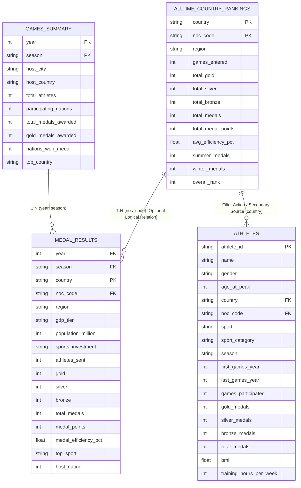

# Olympic Analytics Project — Data Model Plan

## 1. Executive Data Modeling Strategy

A frequent pitfall in multi-table analytics projects is forcing all available CSV files into a single, flat, joined table. In this Olympic dataset, the four tables exist at fundamentally different **grains** (levels of detail). Indiscriminately joining them with traditional SQL/database joins will lead to severe **Cartesian products (fan-out)**, duplicated medal tallies, and invalid aggregations.

### Recommended Architectural Approach
Instead of a single massive join, we implement a **hybrid multi-source model** utilizing **Tableau's Logical Data Model (Relationships / "Noodles")** and **separate dedicated data sources**:

1. **Primary Analytical Data Source (Olympic Games & Medal Analysis):**
   - **Root Table:** `medal_results.csv` (Fact table at Country-Edition grain).
   - **Related Dimension Table:** `games_summary.csv` (Relates on `year` and `season`).
   - Connected via **Tableau Logical Relationship (1-to-many from games to medal results)**. Tableau automatically queries each table at its native grain, avoiding any medal or headcount duplication.

2. **Benchmark & Fast Leaderboard Data Source (All-Time Rankings):**
   - **Standalone Table:** `alltime_country_rankings.csv`.
   - Used for all-time historical ranking, country cards, and summer vs. winter performance profiles without needing to group 910 historical rows.
   - *Alternative:* Can be related to `medal_results.csv` on `noc_code` using Tableau Relationships for drill-through if desired.

3. **Demographic & Biometrics Data Source (Athlete Deep-Dive):**
   - **Independent Data Source:** `athletes.csv`.
   - Athletes are at the individual person grain (8,000 athletes) across multi-year careers. Because `athletes.csv` does **not** contain single-game edition rows (it stores `first_games_year`, `last_games_year`, and career totals), joining it directly to `medal_results.csv` on `country` would cause an catastrophic 1-to-many explosion (e.g., 60 countries $\times$ 910 results $\times$ athletes).
   - Treated as an independent data source in Tableau, linked to Country dashboards via **Tableau Dashboard Filter Actions** on `country` or `noc_code`.

---

## 2. Granularity (Grain) & Entity Definition

| Table Name | Granularity (1 row represents...) | Row Count | Primary Entity | Candidate Primary Key |
| :--- | :--- | :--- | :--- | :--- |
| `games_summary.csv` | One Olympic Games Edition | 18 | Games Edition | Composite: (`year`, `season`) |
| `medal_results.csv` | One National Delegation's Results in a Single Olympic Games Edition | 910 | Country-Edition Result | Composite: (`year`, `country`) or (`year`, `noc_code`) |
| `alltime_country_rankings.csv` | One Participating Country / NOC across all 18 editions | 60 | National Olympic Committee | `noc_code` or `country` |
| `athletes.csv` | One Individual Olympic Competitor across their career | 8,000 | Individual Athlete | `athlete_id` |

---

## 3. Key Relationships & Column Mappings

### 3.1. Relationship: `games_summary` $\longleftrightarrow$ `medal_results`
- **Relationship Type:** One-to-Many ($1 : N$).
- **Matching Join/Relationship Fields:**
  - `games_summary.year` = `medal_results.year`
  - `games_summary.season` = `medal_results.season`
- **Tableau Semantic:** Logical Relationship (default in Tableau Data Source canvas).
- **Referential Integrity:** 100% match. Every one of the 910 records in `medal_results` matches one of the 18 editions in `games_summary`.
- **Duplicate Risk Under Physical Join:** High. If physically joined (Inner/Left Join), `games_summary` fields like `total_athletes` and `participating_nations` will be duplicated across all 43–60 country rows in that edition. Summing `total_athletes` would produce 10,000 $\times$ 56 = 560,000 athletes! In Tableau Relationships, Tableau preserves the native grain and prevents this error.

### 3.2. Relationship: `alltime_country_rankings` $\longleftrightarrow$ `medal_results`
- **Relationship Type:** One-to-Many ($1 : N$).
- **Matching Join/Relationship Fields:**
  - `alltime_country_rankings.noc_code` = `medal_results.noc_code` (or `country = country`).
- **Referential Integrity:** 100% match. All 60 countries exist in both tables.
- **Analytical Utility:** Optional. Useful if the user desires a single data source where country-level all-time ranks appear alongside edition-level records.

### 3.3. Relationship: `athletes` $\longleftrightarrow$ Other Tables
- **Cross-Table Matching Fields:**
  - `country` / `noc_code`
  - `season`
  - `first_games_year` / `last_games_year`
- **Why Athletes Must NOT be Physically Joined to Medal Results:**
  - `athletes.csv` is at the athlete level (8,000 rows).
  - `medal_results.csv` is at the country-edition level (910 rows).
  - `athletes.csv` does **not** have an edition-specific `year` column for each medal won; it has career totals (`gold_medals`, `silver_medals`, `total_medals`).
  - Physically joining on `country` would replicate every athlete 15 to 18 times (once for every Olympic games their country competed in).
  - Furthermore, `athletes.csv` represents a representative cohort of 8,000 athletes, while `medal_results.csv` represents the aggregate national medal count. Summing athlete medals would yield completely false country totals.
- **Recommended Connection:** Independent data source in Tableau, using **Dashboard Actions** (URL/Filter actions) to filter athletes by country when a user clicks a nation in the medal charts.

---

## 4. Visual Data Model (Mermaid Diagram)

---

## 5. Single Source of Truth Matrix

To ensure consistency across dashboards and reports, analysts must adhere to the designated source of truth for each metric:

| Analytical Question / Metric | Authoritative Source of Truth Table | Metric / Field Name | Why this Table is the Source of Truth |
| :--- | :--- | :--- | :--- |
| **Global Olympic Headcount** | `games_summary.csv` | `total_athletes` | Represents official total global participation across all 200+ NOCs. |
| **Total Global Medals Awarded** | `games_summary.csv` | `total_medals_awarded` | Official macro edition total. Verified to match sum of `medal_results.total_medals`. |
| **National Delegation Size** | `medal_results.csv` | `athletes_sent` | Specific count of athletes sent by a given nation to a specific games edition. |
| **Edition Medal Tallies (Country)** | `medal_results.csv` | `gold`, `silver`, `bronze`, `total_medals` | Official country-by-country breakdown per edition. |
| **Edition Efficiency Rate** | `medal_results.csv` | `medal_efficiency_pct` | Exact ratio: `(total_medals / athletes_sent) * 100`. |
| **Host Country Status** | `medal_results.csv` | Corrected `host_nation` (Calculated) | Identifies home-field advantage (with 2012 UK remediation applied). |
| **All-Time Historical Leaderboard** | `alltime_country_rankings.csv` | `overall_rank`, `total_medals` | Pre-calculated cumulative metrics across 18 editions. |
| **Summer vs. Winter Nation Split** | `alltime_country_rankings.csv` | `summer_medals`, `winter_medals` | Directly segments country specialization without multi-pass aggregation. |
| **Athlete Biometrics (Height/Weight/BMI)** | `athletes.csv` | `height_cm`, `weight_kg`, `bmi` | Dedicated individual-level physiological measurements. |
| **Training & Longevity Metrics** | `athletes.csv` | `training_hours_per_week`, `games_participated` | Only table tracking athlete career commitment and endurance. |
| **Doping & World Record Prevalence** | `athletes.csv` | `doping_violation`, `world_record_holder` | Unique athlete integrity and record flags. |

---

## 6. Risk Mitigation & Aggregation Rules

1. **Never Calculate National Medals by Summing `athletes.csv`:**
   - In `athletes.csv`, athlete medals sum to 11,957 medals because multiple athletes win medals in team sports and because `athletes.csv` is a synthetic cohort. Country medals in `medal_results.csv` sum to 6,025 medals. Always use `medal_results.csv` for country medal totals.
2. **Preventing Duplication of Edition-Level Headcounts:**
   - If relating `games_summary` to `medal_results`, never write `SUM(total_athletes)`. In Tableau, use `AVG([total_athletes])` or `{ FIXED [year], [season] : MAX([total_athletes]) }` if working in a physical join, or rely on Tableau Relationships where Tableau automatically isolates the grain.
3. **Correcting the 2012 Host Country Status:**
   - In `medal_results`, Great Britain in 2012 is missing the host flag (`0` instead of `1`). All host nation analysis must use the corrected calculated field.
